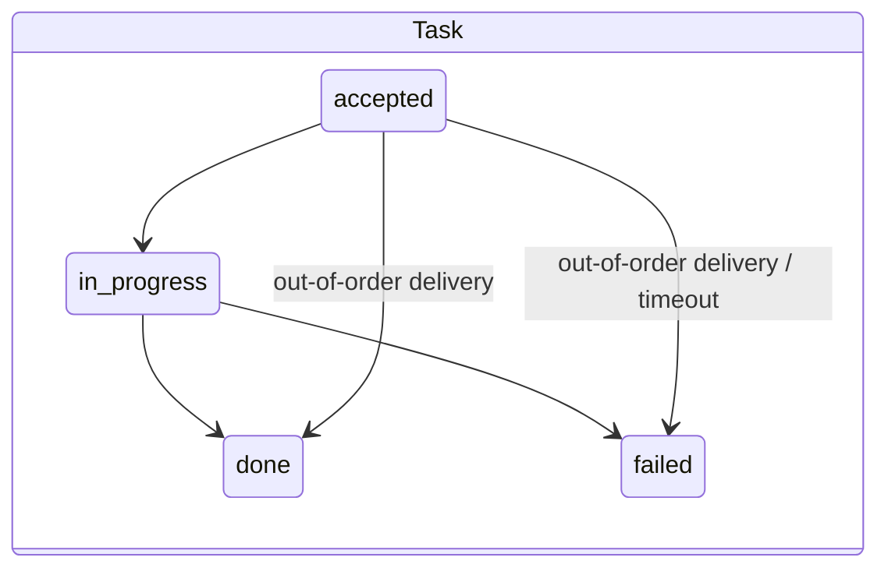
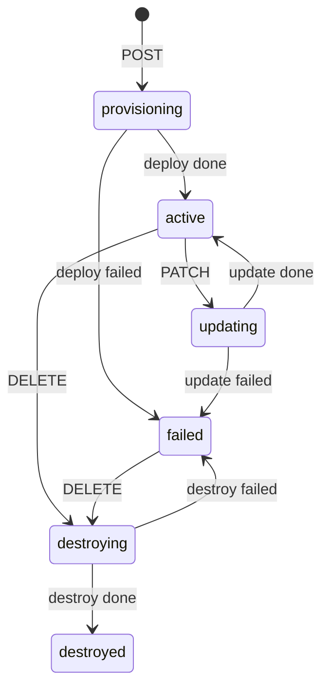
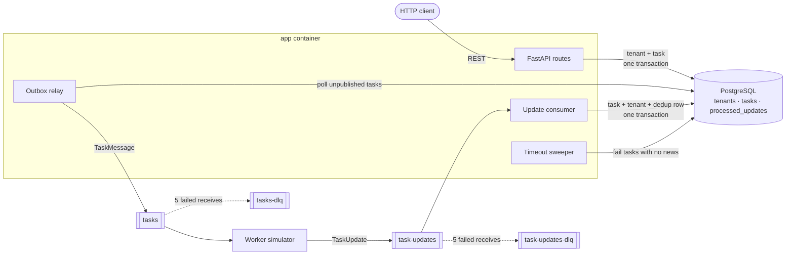

# Tenant Provisioning Control Plane

An HTTP API and message consumer that record tenants, publish provisioning tasks to a
queue, and apply the progress that workers report back. It includes a worker simulator
that you can configure to fail, duplicate, or reorder its updates.

Stack: Python 3.12, FastAPI, PostgreSQL 16, SQLAlchemy (async) + Alembic, and
ElasticMQ (a local SQS-compatible broker) through aioboto3. Everything runs in Docker Compose.

## Quick start

You need Docker with Compose v2. Nothing else has to be installed on the host.

```bash
git clone <repo-url> && cd <repo-dir>
docker compose up -d --build              # boot: postgres, elasticmq, migrations, app, worker
docker compose run --rm --build tests     # test: ruff lint + ruff format check + pytest
```

The test suite runs against the booted stack (it calls the live API and broker), so
run the boot command first.

| What                   | Where                           |
| ---------------------- | ------------------------------- |
| API                    | http://localhost:8001/v1        |
| OpenAPI / Swagger UI   | http://localhost:8001/docs      |
| ElasticMQ UI           | http://localhost:9326           |
| Postgres               | localhost:5432 (`postgres` / `postgres`, local only) |

The credentials in `docker-compose.yml` (`postgres`, `test`/`test` for SQS) are
throwaway values for the local containers, not secrets.

Stop everything with `docker compose down`. Add `-v` to also delete the data volumes.

## Walkthrough

```bash
# create: tenant starts in provisioning, a deploy task is accepted
curl -s -X POST localhost:8001/v1/tenants \
  -H 'content-type: application/json' -d '{"slug":"acme","name":"Acme"}'
```

```json
{
  "tenant": {"id": "b0a85f42-...", "slug": "acme", "name": "Acme",
             "status": "provisioning", "version": 1,
             "created_at": "2026-11-14T17:30:44.894Z", "updated_at": "2026-11-14T17:30:44.894Z"},
  "task":   {"id": "76fec735-...", "type": "deploy", "tenant_id": "b0a85f42-...",
             "status": "accepted", "error": null,
             "created_at": "2026-11-14T17:30:44.894Z", "updated_at": "2026-11-14T17:30:44.894Z"}
}
```

A second or two later, the worker has driven the task `accepted` → `in_progress` → `done`
and the tenant is `active`:

```bash
T=<tenant id>
curl -s localhost:8001/v1/tenants/$T            # "status": "active", "version": 2
curl -s localhost:8001/v1/tenants/$T/tasks      # deploy task, "status": "done"

# update (needs the current version)
curl -s -X PATCH localhost:8001/v1/tenants/$T \
  -H 'content-type: application/json' -d '{"name":"Acme Inc","version":2}'

# a stale version is rejected
curl -s -X PATCH localhost:8001/v1/tenants/$T \
  -H 'content-type: application/json' -d '{"name":"Acme Inc","version":1}'
# {"error":{"code":"tenant_version_conflict","message":"tenant ... is at version 4, not 1",
#           "details":{"current_version":4,"expected_version":1}}}

# delete (version is optional; when given it is checked like PATCH)
curl -s -X DELETE "localhost:8001/v1/tenants/$T?version=4"   # -> destroying -> destroyed
```

## API

All routes are under `/v1`. Request and response bodies are JSON. Timestamps are ISO 8601 in UTC
with milliseconds and a `Z` suffix.

| Method   | Path                          | Purpose                                         | Success |
| -------- | ----------------------------- | ----------------------------------------------- | ------- |
| `POST`   | `/tenants`                    | Create a tenant, starts a `deploy` task         | `202` + `Location` |
| `GET`    | `/tenants`                    | List tenants                                    | `200`   |
| `GET`    | `/tenants/{id}`               | Get one tenant                                  | `200`   |
| `PATCH`  | `/tenants/{id}`               | Rename, starts an `update` task                 | `202`   |
| `DELETE` | `/tenants/{id}[?version=N]`   | Destroy, starts a `destroy` task                | `202`   |
| `GET`    | `/tenants/{id}/tasks`         | Tasks of one tenant                             | `200`   |
| `GET`    | `/tasks`                      | List all tasks                                  | `200`   |
| `GET`    | `/tasks/{id}`                 | Get one task                                    | `200`   |
| `GET`    | `/healthz`                    | Liveness (outside `/v1`)                        | `200`   |

Every call that changes a tenant returns **`202 Accepted`** with `{"tenant": ..., "task": ...}`.
The work finishes asynchronously; poll the tenant or `GET /tasks/{task.id}` to follow it.

**Request bodies**

- `POST /tenants`: `{"slug": "...", "name": "..."}`. The slug must match
  `^[a-z][-a-z0-9]{1,26}[a-z0-9]$` (3–28 chars, valid as a k8s namespace). The name is 1–200
  characters with no control characters. Unknown fields are rejected.
- `PATCH /tenants/{id}`: `{"name": "...", "version": N}`. `name` is the only field you can
  change, and `version` is required.

**Lists and filters.** Lists are sorted newest first and paginated with `limit` (1–100,
default 20) and `offset`. Each list returns `{"items": [...], "limit", "offset", "has_more"}`,
and `has_more` is computed by fetching one extra row instead of running a `COUNT`.

- `GET /tenants?status=active`
- `GET /tasks?tenant_id=...&status=failed&type=deploy`
- `GET /tenants/{id}/tasks?status=...&type=...` (returns `404 tenant_not_found` if the tenant doesn't exist)

### Errors

Every error has the same shape:

```json
{"error": {"code": "tenant_update_not_allowed", "message": "not allowed in status 'provisioning'",
           "details": {"status": "provisioning", "allowed_statuses": ["active"]}}}
```

| Code                        | HTTP | When                                                         |
| --------------------------- | ---- | ------------------------------------------------------------ |
| `validation_error`          | 422  | Body, path, or query parameters failed validation (`details.errors` lists them) |
| `tenant_not_found`          | 404  | No tenant with that id                                       |
| `task_not_found`            | 404  | No task with that id                                         |
| `tenant_already_exists`     | 409  | The slug is taken, including by a `destroyed` tenant         |
| `tenant_version_conflict`   | 409  | `version` doesn't match the current one (`details.current_version`) |
| `tenant_update_not_allowed` | 409  | The tenant's status doesn't allow this operation (`details.allowed_statuses`) |
| `not_found`                 | 404  | Unknown route                                                |
| `method_not_allowed`        | 405  | Wrong HTTP method                                            |
| `internal_error`            | 500  | Unexpected failure. It is logged; the client never sees a stack trace |

All conflicts with current state use `409`. The `code` tells a client which kind of conflict
it is: refetch and retry for a version conflict, wait for a status change for a
not-allowed one.

## State machines





- A task can go from `accepted` straight to a terminal status. If `done` arrives before
  `in_progress`, it is applied, and the late `in_progress` is ignored as stale.
- A tenant's `version` goes up on every change, including the status changes that a
  finished task causes. An `in_progress` update doesn't change the tenant, so it doesn't
  change the version either.
- Tenants are never deleted from the database. A `destroyed` tenant keeps its slug forever.

## Architecture



| Container   | Role |
| ----------- | ---- |
| `postgres`  | System of record. Data lives in the `pgdata` volume and survives restarts |
| `elasticmq` | SQS-compatible broker. Queues are defined in [elasticmq.conf](elasticmq.conf) and persisted in `mqdata` |
| `migrate`   | Runs `alembic upgrade head` once, then exits. `app` waits for it to finish |
| `app`       | The control plane. Runs the API plus three background loops in one process ([app/main.py](app/main.py)) |
| `worker`    | The simulator ([app/worker.py](app/worker.py)) |

| Module | Responsibility |
| ------ | -------------- |
| [app/api.py](app/api.py) | Routes and error handlers |
| [app/tenants.py](app/tenants.py) | Tenant transitions with their guards, and `finish_task`, which every path that ends a task shares |
| [app/relay.py](app/relay.py) | Outbox relay: publishes committed tasks |
| [app/consumer.py](app/consumer.py) | Applies worker updates: dedup, ordering by status rank, retries |
| [app/sweeper.py](app/sweeper.py) | Fails tasks the worker has gone quiet on |
| [app/schemas.py](app/schemas.py) | API models and both message schemas |
| [migrations/](migrations/versions/0001_initial.py) | Schema, constraints and indexes |
| [redrive.py](redrive.py) | Moves messages from a dead-letter queue back to its source queue |

## Messaging

### Outbound: `tasks` queue

The task row is the outbox. Each tenant API call inserts or updates the tenant and inserts
the task **in one transaction** and publishes nothing itself. The relay polls for committed tasks with
`published_at IS NULL AND status = 'accepted'` (`FOR UPDATE SKIP LOCKED`, one task per
transaction), sends each one, then sets `published_at`. Because of this:

- A rolled-back request (validation error, 409, crash) never produces a message, since
  the row it would publish never existed.
- If the broker is down, the API keeps accepting requests. Tasks wait in the table and go
  out once the broker is back (exponential backoff with jitter, capped at 30s).
- A crash between `send_message` and the commit sends the task again. Delivery is
  **at-least-once**, and the worker's idempotency keys (below) absorb the duplicate.
- A task the broker refuses as malformed (`InvalidMessageContents`) is marked `failed`
  so it can't block the queue behind it.

```json
{"id": "76fec735-...", "type": "deploy", "tenant_id": "b0a85f42-...", "status": "accepted",
 "created_at": "2026-11-14T17:30:44.894Z", "tenant": {"slug": "acme", "name": "Acme"}}
```

`id` is the task id and also the event id.

### Inbound: `task-updates` queue

```json
{"update_id": "76fec735-...:done", "task_id": "76fec735-...", "status": "done",
 "occurred_at": "2026-11-14T17:30:46.300Z", "error": null}
```

`status` is `in_progress`, `done` or `failed`. Only the control plane creates tasks in
`accepted`. The worker builds `update_id` as `<task_id>:<status>`, so a redelivered task
produces the same keys again.

The consumer applies each update in one transaction:

1. `SELECT ... FOR UPDATE` on the task, which serializes concurrent deliveries for the same
   task. An unknown `task_id` raises an error.
2. `INSERT INTO processed_updates ... ON CONFLICT DO NOTHING`. If the key is already
   there, the update is a **duplicate**, nothing changes, and the message is acked.
3. Compare status ranks (`accepted 0 < in_progress 1 < done = failed 2`). An update that
   doesn't move the task forward is **stale** and is acked without changes. That covers
   `in_progress` after `done` and anything sent for a task that is already finished. A
   conflicting terminal status (`failed` after `done`) is logged as a warning.
4. Otherwise apply it. A terminal status also moves the tenant, but only if the tenant is
   still in the status that matches the task type (`provisioning` for a deploy, and so
   on). The tenant's version goes up.

The dedup row, the task change and the tenant change commit together or not at all.

Failure handling:

- A message is deleted only after its transaction commits, so a crash means redelivery,
  never a lost update.
- A message that fails (bad JSON, unknown task, DB error) isn't deleted. It comes back
  after the 10s visibility timeout, and after 5 receives SQS moves it to `task-updates-dlq`.
  The consumer loop never dies.
- After a failure the consumer checks the database and stops receiving until it is
  reachable again, so an outage doesn't push good messages into the DLQ.
- Receive errors from the broker are retried with exponential backoff and jitter.

### Stuck tasks

The worker can lose a task: it crashes, or the task message ends up in `tasks-dlq`. The
sweeper therefore fails any published task that has been open with no update for
**360s** (`TASK_TIMEOUT_S`). That is longer than 5 deliveries × the 60s visibility timeout of
`tasks`, so a task isn't timed out while SQS is still redelivering it. The tenant moves to `failed`,
which can then be `DELETE`d. A `done` that arrives after the timeout is ignored as stale
and logged as a warning.

## Concurrency

Each guard is a single conditional SQL statement. The database decides; there is no
check-then-write in Python.

| Race | Mechanism | Result |
| ---- | --------- | ------ |
| Two creates with the same slug | `INSERT ... ON CONFLICT (slug) DO NOTHING RETURNING` | One `202`, the rest `409 tenant_already_exists` |
| Two PATCHes with the same version | `UPDATE ... WHERE id = ? AND status IN (...) AND version = ? RETURNING` | One `202`, the rest `409 tenant_version_conflict` |
| Two DELETEs | Same, guarded on status | One `202`, the rest `409` |
| Same update delivered twice at once | Row lock on the task + primary key on `processed_updates` | Applied once |
| Several relay instances | `FOR UPDATE SKIP LOCKED` | Each task is sent by one relay at a time |

When the conditional `UPDATE` matches no row, a follow-up read decides which error to
return: not found, version conflict, or status not allowed. As a last line of defence, a
partial unique index (`uq_tasks_one_open`) allows at most one `accepted`/`in_progress`
task per tenant, even if a guard were wrong.

The concurrency tests fire 30 identical requests with `asyncio.gather` and assert exactly
one winner.

## Reproducing failure scenarios

### By restarting the worker with different settings

| Variable                | Default | Effect |
| ----------------------- | ------- | ------ |
| `WORKER_FAIL_RATE`      | `0`     | Probability (0–1) that a task ends `failed` |
| `WORKER_DUPLICATE_RATE` | `0`     | Probability that each update is sent twice |
| `WORKER_REORDER`        | `false` | Send the terminal update **before** `in_progress` |
| `WORKER_MIN_DELAY_MS`   | `500`   | Minimum simulated work time |
| `WORKER_MAX_DELAY_MS`   | `2000`  | Maximum simulated work time |

```bash
WORKER_FAIL_RATE=1 docker compose up -d worker        # every task fails -> tenant failed
WORKER_DUPLICATE_RATE=1 docker compose up -d worker   # every update twice -> logged as "duplicate"
WORKER_REORDER=true docker compose up -d worker       # done before in_progress -> in_progress "stale"
docker compose stop worker                            # tasks stay accepted; the sweeper fails them after 360s
docker compose up -d worker                           # back to defaults
```

Follow what the consumer does with `docker compose logs -f app`. Each update is logged as
`applied`, `duplicate` or `stale`.

### By publishing directly to the broker

The `aws` service (Compose profile `tools`) runs the AWS CLI against ElasticMQ.
Queue URLs have the form `http://elasticmq:9324/000000000000/<queue>`.

```bash
Q=http://elasticmq:9324/000000000000/task-updates
TASK=<task id>

# a late, conflicting outcome for a finished task -> "stale" plus a warning
docker compose run --rm aws sqs send-message --queue-url $Q --message-body \
  '{"update_id":"manual-1","task_id":"'$TASK'","status":"failed","occurred_at":"2026-01-01T00:00:00.000Z","error":"injected"}'

# the same update_id again -> "duplicate"
docker compose run --rm aws sqs send-message --queue-url $Q --message-body \
  '{"update_id":"manual-1","task_id":"'$TASK'","status":"failed","occurred_at":"2026-01-01T00:00:00.000Z"}'

# poison message -> retried 5 times, then moved to task-updates-dlq; the consumer keeps going
docker compose run --rm aws sqs send-message --queue-url $Q --message-body 'not json'

# inspect a dead-letter queue
docker compose run --rm aws sqs receive-message \
  --queue-url http://elasticmq:9324/000000000000/task-updates-dlq --max-number-of-messages 10
```

### Redriving dead letters after an outage

```bash
docker compose exec app python redrive.py task-updates   # task-updates-dlq -> task-updates
docker compose exec app python redrive.py tasks          # tasks-dlq -> tasks
```

The script sends each message first and deletes it afterwards, so a crash can only
duplicate a message, which the consumer deduplicates.

## Quality gates

`docker compose run --rm --build tests` runs, in order and stopping at the first failure:

1. `ruff check .`: lint (pycodestyle, pyflakes, isort, bugbear, pyupgrade, simplify, async
   rules) plus static security analysis with the bandit rule set (`S`)
2. `ruff format --check .`: every file must already be formatted
3. `pip-audit --strict`: checks every package installed in the image against known
   vulnerabilities (PyPI advisory database / OSV), including pip itself. This step needs
   network access
4. `pytest -v`: the integration suite in [tests/test_flow.py](tests/test_flow.py), against
   the real Postgres, ElasticMQ, app and worker

Bandit exceptions are listed in [pyproject.toml](pyproject.toml), each with its reason:
`assert` in tests, and `random` for backoff jitter and the simulated worker, where no
cryptographic randomness is needed. The Dockerfile upgrades the base image's pip because
pip-audit flags the bundled version.

What the suite covers:

- **State machine:** the full lifecycle create → update → destroy, a slug reserved after
  destroy, PATCH refused while provisioning, a stale version rejected, and DELETE from `failed`.
- **Concurrency:** 30 parallel creates, PATCHes and DELETEs, each with exactly one winner, and
  10 parallel deliveries of the same update applied once.
- **Messaging:** duplicates, `done` arriving before `in_progress`, terminal statuses that never
  change, unknown tasks, a poison message reaching the DLQ, redrive, the backoff
  bounds, an unsendable task failing without blocking the relay, a task already in progress not
  being republished, and the sweeper's timeout behaviour.
- **API contract:** the error shape and code for validation errors, 404s and 405s, plus pagination and filters.

## Design decisions and trade-offs

- **Transactional outbox instead of publishing in the request.** Publishing after the
  commit inside the handler can still lose the event if the process dies between the
  commit and the send. The relay makes "commit, then publish" survive crashes. The cost is
  polling latency (0.3s when idle) and at-least-once delivery.
- **The task is the outbox row.** The spec says the task *is* the event, so there is no
  separate outbox table, just a `published_at` column and a partial index on unpublished rows.
- **Database guards instead of application locks.** Conditional `UPDATE`/`INSERT`
  statements make each check and its write one atomic step, and they still work with any
  number of API replicas.
- **The dedup table is keyed on `update_id` and grows forever.** That's fine for this
  exercise. A real system would prune rows older than the broker's maximum redelivery window.
- **Ordering by status rank, not by timestamp.** `occurred_at` comes from the worker's
  clock, so the consumer doesn't trust it for ordering. The state machine only moves forward,
  so comparing ranks is enough.
- **The worker can't move a tenant that isn't in the matching open status.** If a tenant
  was already failed by the sweeper, a late `done` updates nothing and is logged.
- **SQS semantics (ElasticMQ) instead of RabbitMQ/Kafka.** Visibility timeouts and
  redrive-to-DLQ give retries and poison-message isolation without extra code, and the same
  client code works against real SQS.
- **Everything in one `app` process.** The API, relay, consumer and sweeper share one
  container to keep the setup simple. Each loop is safe to run in several replicas
  (`SKIP LOCKED`, row locks, dedup), so they could be split into separate deployments later.
- **Offset pagination.** It is simple and good enough here, but pages can shift while rows
  are being inserted. Keyset pagination on `(created_at, id)` would fix that.
- **`DELETE` takes `version` optionally.** The status guard already prevents double
  deletes. Clients that want the full lost-update protection can pass `?version=`.
- **`202 Accepted` for every change.** The response includes the task so the client knows what to poll.

## Project layout

```
app/            control plane (api, tenants, relay, consumer, sweeper) and the worker
migrations/     Alembic migration: tables, CHECK constraints, partial indexes
tests/          integration test suite
redrive.py      DLQ redrive tool
elasticmq.conf  queues, visibility timeouts, DLQ policies
```
